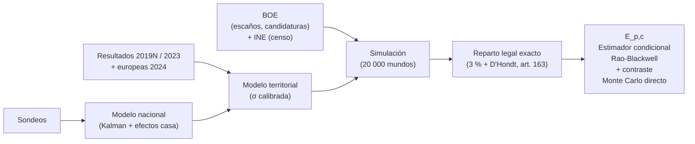

# electoral-lab

<p align="center">
  
</p>

Laboratorio electoral local para las elecciones generales del **29 de noviembre de 2026** (Congreso).
Obtiene datos oficiales y sondeos, modela la incertidumbre, simula resultados, aplica el reparto legal
de la LOREG por circunscripción y estima **E_p,c**: la probabilidad de que **un voto adicional** a la
candidatura *p* en la circunscripción *c* cambie la asignación de escaños.

- **Demo**: [elecciones29n.streamlit.app](https://elecciones29n.streamlit.app/)
- **Código**: este repositorio, bajo licencia MIT.

## Motivación

En cada campaña se repite la idea de que «los votos a ciertos partidos cuentan más». Unos lo atribuyen a
D'Hondt; otros, a una supuesta ventaja de los partidos regionalistas. D'Hondt y el umbral del 3 % influyen,
pero el punto de partida es otro: el Congreso no reparte los escaños con el total de votos de España, sino
**circunscripción por circunscripción** (LOREG, arts. 161–163). Importa cuántos votos recibe un partido, pero también **dónde**.

Un ejemplo ficticio: cuatro territorios eligen un diputado cada uno. El partido A recibe 3 millones de votos,
750 000 en cada territorio, sin ganar en ninguno: obtiene 0 escaños. El partido B concentra 2 millones en dos
territorios, un millón en cada uno, y gana ambos: obtiene 2 escaños con menos votos en total.

Dividir votos entre escaños después de unas elecciones describe un resultado, pero no responde a la pregunta
que interesa antes de votar: **¿qué probabilidad hay de que un voto más a una candidatura cambie un escaño
en mi circunscripción?** electoral-lab intenta estimarlo de forma transparente y reproducible: combina
sondeos y resultados anteriores, modela la incertidumbre, simula miles de escenarios y aplica en cada uno
las reglas legales de reparto.

Es un prototipo experimental y educativo. La cercanía a un escaño es solo un dato más: no sustituye las
ideas, prioridades o programas que cada persona quiera apoyar, y **no es una recomendación de voto**.

## Cómo funciona



1. Los sondeos se agregan en una estimación nacional por partido, corrigiendo el sesgo de cada encuestadora.
2. Los resultados de elecciones anteriores reparten esa estimación entre provincias y fijan cuánto puede
   desviarse cada una.
3. Se simulan 20 000 escenarios posibles del 29-N con votos enteros por candidatura y circunscripción.
4. En cada escenario se aplica el reparto legal exacto y se mide cuánto falta para cada escaño.
5. Con todo ello se estima E_p,c para las circunscripciones elegidas.

Los términos del diagrama se explican en [Conceptos clave](#conceptos-clave).

## Requisitos

- macOS o Linux, [uv](https://docs.astral.sh/uv/) ≥ 0.4. Python 3.12 se instala solo (`.python-version`).

## Instalación

```bash
git clone git@github.com:borlafu/electoral-lab.git ~/code/electoral-lab
cd ~/code/electoral-lab
uv sync
export ELECTORAL_LAB_CONTACT="tu@email"   # se envía en el User-Agent al descargar fuentes
```

El repositorio incluye una instantánea de datos en `data/seed/` (sondeos hasta el 9-11-2026), así que
puede ejecutarse sin red.

## Uso

```bash
uv run electoral data validate                 # comprueba datos y reproduce el reparto oficial 2019N y 2023
uv run electoral run "A Coruña" Madrid Bilbao  # lista explícita; acepta provincias o municipios
uv run electoral run --all                     # E_p,c para las 52 circunscripciones (tarda más)
uv run electoral report                        # vuelve a imprimir el informe de la última ejecución
uv run electoral ui                            # interfaz web local en http://localhost:8501

uv run electoral sources refresh               # vuelve a descargar BOE, INE, sondeos y resultados
uv run electoral sources refresh --only polls  # solo sondeos
uv run electoral sources list                  # registro de descargas (hash, fecha, URL)
uv run electoral data seed                     # promueve los datos normalizados actuales a data/seed

# sensibilidad
uv run electoral run Málaga --set territorial.sigma_scale=0.7 --sims 40000
uv run electoral run Sevilla --set national.election_day_sd=0.12

# resultados oficiales del Ministerio del Interior (si descargas el ZIP a mano)
uv run electoral sources import-interior 02_202307_1.zip --election congreso_2023
```

Cada ejecución crea `data/runs/<fecha>_<hash>_<elección>/` con `manifest.json` (semilla, hashes de datos
y configuración, commit), CSV de resultados y `pivotal.csv` con E_p,c.

`electoral run` requiere una lista de lugares o `--all`: no tiene circunscripciones por defecto,
y no permite combinar ambos modos. Los nombres compuestos deben ir entre comillas en la consola
(`"A Coruña"`, `"Ciudad Real"`, `"Santa Cruz de Tenerife"`). Los alias que resuelven a la misma
circunscripción se calculan una sola vez (por ejemplo, Bilbao y Bizkaia).
La simulación nacional mantiene su cobertura completa; la selección delimita dónde se estima E_p,c
y se guardan las simulaciones detalladas.

En la interfaz, selecciona una o varias circunscripciones en el multiselector, o marca
«Todas las circunscripciones». No hay ninguna preseleccionada. Los nombres compuestos se conservan
sin dividirse por espacios, y los resultados de E_p,c se exploran mediante un desplegable.

## Conceptos clave

**E_p,c (eficacia marginal del voto).** Número esperado de escaños que gana la candidatura *p* en la
circunscripción *c* si recibe **un voto más**, manteniendo todo lo demás igual:

$$E_{p,c} = \mathbb{E}\big[A_p(V_p + 1) - A_p(V_p)\big]$$

donde $V_p$ son los votos de *p* en *c*, $A_p(V_p)$ es el número de escaños que el reparto legal le daría con
esos votos (con los votos de las demás candidaturas fijos) y la esperanza $\mathbb{E}$ promedia sobre todos
los escenarios simulados. Un voto solo cambia algo cuando la candidatura está justo en el umbral de un escaño,
así que E es en la práctica la **probabilidad de que tu voto sea decisivo** para un escaño. Siempre es un
número muy pequeño: del orden de 1 entre decenas o cientos de miles para candidaturas que compiten por un
escaño, y mucho menor para las que están lejos de ganarlo o de perderlo. Cuanto mayor, más «pesa» el voto.
Mide eficacia en escaños, **no** utilidad: no incorpora preferencias, gobernabilidad, pactos ni financiación
electoral. No es una recomendación de voto.

**E_p,c no es lo mismo que «votos por escaño».** Dividir los votos de un partido entre sus escaños es una media
*a posteriori*: describe lo que ya pasó. E_p,c es un efecto *marginal* y *a priori*: qué cambiaría un voto más,
teniendo en cuenta que antes de las elecciones no sabemos el resultado. Un partido puede necesitar muchos votos
por escaño y, aun así, tener un E alto en una provincia donde está a punto de ganar el último.

**Voto válido.** Votos a candidaturas más votos en blanco; los nulos no cuentan. Es la base sobre la que se
calcula el umbral del 3 % y las cuotas de voto de este README.

**Circunscripción.** La provincia (más Ceuta y Melilla). Cada una reparte sus propios escaños; un voto solo
influye en los escaños de su provincia. Si escribes un municipio (Bilbao) se resuelve a su provincia (Bizkaia).

**Reparto legal (LOREG art. 163).** En cada circunscripción: (1) se descartan las candidaturas con menos del
3 % de los votos válidos (candidaturas + blanco); (2) se dividen los votos de las restantes entre 1, 2, 3…;
(3) los escaños van a los cocientes mayores (método D'Hondt). Un *cociente* es el resultado de dividir los
votos de una candidatura entre 1, 2, 3…; el *último cociente* es el más bajo que todavía obtiene escaño, y es
el que se disputa en el margen. Empates de cociente: gana quien tiene más votos;
si persiste, sorteo. Ceuta y Melilla eligen un diputado por mayoría simple (art. 170).

**Por qué E cambia entre partidos.** Un voto vale más cuando la candidatura está cerca de ganar (o de perder)
su último escaño en muchos escenarios plausibles. Depende del tamaño de la circunscripción, de lo ajustado que
esté el último cociente y de la incertidumbre. Un partido sin opciones de escaño, o con su último escaño muy
seguro, tiene E bajo. El voto que no hace ganar escaño a tu partido puede, aun así, quitárselo a otro: E cuenta
el escaño que gana *p* (que siempre sale de otra candidatura, indicada en «desplaza a»).

**Escalera A_p(n).** Si se fijan los votos de las demás candidaturas y se van sumando votos a *p*, sus escaños
suben a saltos, como una escalera: no cambian durante miles de votos y, de repente, un voto más le da un escaño.
Cada peldaño es un *umbral*; E_p,c es la probabilidad de que el resultado real caiga justo antes de uno.

**Escenario / simulación.** Un «mundo posible» del 29-N: una cuota nacional por partido (con error de
sondeos), una participación y un voto provincial con ruido calibrado. Se simulan 20 000 y en cada uno se
aplica el reparto legal exacto. Las probabilidades del informe son frecuencias sobre esos mundos.

**Agregado de sondeos (filtro de Kalman).** La intención de voto de cada grupo se modela como una tendencia
que cambia poco a poco día a día (*paseo aleatorio*). El filtro de Kalman combina esa tendencia con cada
sondeo nuevo, dando más peso a los más grandes y recientes, y produce una estimación diaria con su incertidumbre.

**Logit.** Transformación $\log\big(p/(1-p)\big)$ de una cuota de voto $p$. Se usa para modelar errores en una
escala que respeta los límites 0–100 %: el mismo error en logit mueve más puntos a un partido del 30 % que a uno
del 3 %. Como referencia, 0,1 en logit ≈ 2 puntos para un partido del 30 %.

**Efecto casa.** Sesgo sistemático de cada encuestadora hacia un partido (p. ej. una empresa que da siempre
1 punto más al PP). Se estima y se descuenta; se supone que el sesgo medio del conjunto de empresas es cero.

**Error del día de la elección.** Error común a todas las encuestas (todas fallan a la vez en la misma
dirección). Se añade aparte, con una componente compartida por bloque izquierda/derecha: si las encuestas
infravaloran a un partido de un bloque, tienden a infravalorar también a sus socios.

**Error provincial (σ territorial).** Cuánto puede desviarse el voto de una candidatura en una provincia
respecto a lo que predice la tendencia nacional. Se calibra con cómo cambió el voto de cada provincia entre
2019N y 2023, y es mayor en proporción para los partidos pequeños. Parte del error es común a todas las
provincias de una misma comunidad autónoma.

**Intervalo 90 % (p05–p95).** El 90 % de los escenarios cae dentro del intervalo: el 5 % por debajo de p05 y
el 5 % por encima de p95.

**Estimador condicional (Rao-Blackwell) vs. Monte Carlo directo.** Sumar un voto y volver a repartir casi
nunca cambia nada en 20 000 simulaciones, así que el conteo directo es muy ruidoso. El estimador condicional
calcula analíticamente, en cada escenario, la probabilidad de caer justo en el umbral de un escaño; da el
mismo valor esperado con mucha menos varianza (el nombre viene del teorema de Rao-Blackwell, que garantiza
esa mejora al promediar una probabilidad calculada en lugar de un conteo de 0 y 1). El contraste directo se
hace con +1000 votos (`M1000`).

**M_k.** Escaños esperados que añadirían *k* votos más (k = 10, 100, 1000). Si la probabilidad de estar cerca de
un umbral es parecida a esa escala, M_k ≈ k × E.

**Desplaza a.** Todo escaño que gana una candidatura lo pierde otra en la misma circunscripción. «Desplaza a»
indica a quién se lo quitaría tu voto con más frecuencia cuando resulta decisivo.

## Siglas de partidos

| Sigla | Candidatura | Sigla | Candidatura |
|---|---|---|---|
| PP | Partido Popular | ERC | Esquerra Republicana de Catalunya |
| PSOE | PSOE (con PSC, PSdeG, PSE-EE, PSN, PSIB) | JUNTS | Junts per Catalunya |
| VOX | Vox | BILDU | EH Bildu |
| FA | Frente Amplio y coaliciones territoriales (espacio de Sumar) | PNV | EAJ-PNV |
| FV | Compromís: Front Valencià | BNG | Bloque Nacionalista Galego |
| FA_FV | FA + FV como grupo nacional (los sondeos suelen publicarlos juntos) | CCA | Coalición Canaria |
| PODEMOS | Podemos | ADELANTE | Adelante Andalucía |
| SALF | Se Acabó La Fiesta | SY / EXISTE / GBAI | Soria ¡Ya! / Teruel Existe / Geroa Bai |
| OTROS | resto de candidaturas agregadas: cuentan para la base del 3 %, no obtienen escaño | | |

## Informe en consola (`electoral run` / `electoral report`)

- **Estimación nacional**: % de voto válido el 29-N e intervalo 90 % del agregado de sondeos (sin el error
  del día de la elección, que sí entra en la simulación de escaños).
- **Escaños**: media e intervalo 90 %; `P(1.ª fuerza)` = probabilidad de ser el partido con más escaños.
  `Bloque derecha ≥176` = probabilidad de que PP + Vox (+ SALF) sumen mayoría absoluta.
- **Tabla por circunscripción**:

| columna | significado |
|---|---|
| `escaños` | escaños medios de la candidatura en esa provincia |
| `E (por 100k votos)` | E_p,c × 100 000: escaños esperados que añadirían 100 000 votos «sueltos», o equivalentemente probabilidad de ser decisivo × 100 000. Comparable entre partidos y provincias |
| `1 entre…` | 1 / E: tu voto es decisivo en uno de cada N casos (— si es prácticamente nulo) |
| `M(1000)` | escaños esperados que añaden 1000 votos adicionales (≈ 1000 × E si la probabilidad de estar cerca de un umbral es parecida a esa escala) |
| `directo` | lo mismo medido por Monte Carlo directo (contraste del estimador) |
| `desplaza a` | candidatura que con más frecuencia pierde el escaño cuando tu voto es decisivo |

## Ficheros de una ejecución (`data/runs/<run_id>/`)

**`pivotal.csv`** – eficacia marginal por provincia y partido

| columna | significado |
|---|---|
| `province`, `province_name` | código INE y nombre de la circunscripción |
| `party` | sigla de la candidatura |
| `seats_mean` | escaños medios simulados |
| `E` | E_p,c: escaños esperados por un voto adicional (≈ probabilidad de ser decisivo) |
| `se` | error estándar Monte Carlo de `E` |
| `one_in` | 1 / E |
| `E_per_100k` | E × 100 000 |
| `M10`, `M100`, `M1000` | escaños esperados por +10, +100, +1000 votos (estimador condicional) |
| `direct_M1000`, `direct_M1000_se` | M1000 por Monte Carlo directo y su error estándar |
| `ess` | tamaño muestral efectivo (*effective sample size*): cuántos escenarios aportan información real al estimador; si es bajo, `E` es menos fiable |
| `n_sims` | escenarios usados en el estimador condicional |
| `median_votes_to_next` | mediana de los votos que le faltan para el siguiente escaño |
| `top_displaced` | partido al que con más frecuencia quitaría el escaño |

**`pivotal_detail.json`** – por `<provincia>_<partido>`: `displaced` (reparto de a quién quita el escaño),
`causes` (`cociente` = gana el último cociente D'Hondt; `umbral_propio` = la candidatura supera el 3 %; `salida_umbral_ajeno` = otra candidatura cae por debajo del 3 % al crecer la base; `sorteo` = rompe un empate),
`increments` (M1, M10, M100, M1000) y sus errores. `dist_next_<prov>_<partido>.npy` guarda, por escenario, los
votos que faltan para el siguiente escaño.

**`seats_national.csv`**: `party`, `mean`, `p05`, `p50` (mediana), `p95`, `p_largest` (prob. de ser 1.ª fuerza).

**`seats_province.csv`**: `seats_total` (escaños en juego), `mean`, `p05`, `p95`, `p_at_least_1` (prob. de obtener
al menos un escaño).

**`votes_province.csv`**: `share_mean`, `share_p05`, `share_p95` (cuota sobre voto válido, 0–1) y `p_over_3pct`
(prob. de superar el umbral del 3 %).

**`national_summary.csv`** – agregado de sondeos por grupo

| columna | significado |
|---|---|
| `group` | grupo nacional (FA_FV agrupa FA y Compromís) |
| `n_obs` | sondeos usados |
| `now`, `E_mean` | estimación actual y proyectada al 29-N (cuota 0–1) |
| `E_lo`, `E_hi` | intervalo 90 % del agregado (sin error del día E) |
| `rw_sd_daily` | volatilidad diaria de la intención de voto (escala logit) |
| `tau` | ruido extra por sondeo más allá del muestral |
| `house_sd` | dispersión de los efectos casa entre encuestadoras |

**`national_trend.csv`**: serie diaria `share` con banda `lo`–`hi`. **`house_effects.csv`**: `house_logit` = sesgo
estimado de cada encuestadora para cada grupo (positivo = sobreestima; 0,1 en logit ≈ 2 puntos para un partido
del 30 %). **`polls_used.csv`**: sondeos tras filtros, con `n_eff` (muestra efectiva = min(n, 2500) × 0,6) y
`FA_FV_imputed` (si FV se imputó porque no se publicaba).

**`manifest.json`**: semilla, número de simulaciones, hashes de datos y configuración, commit de git, último
sondeo, modelo de error provincial (`sigma_model`) y resumen de bloques. **`sims.npz`**: escaños nacionales por
escenario y votos/escaños de las provincias pedidas.

## Parámetros de sensibilidad más útiles

| clave `--set` | por defecto | efecto |
|---|---|---|
| `territorial.sigma_scale` | 1.0 | multiplica el error provincial; menor = provincias más predecibles |
| `national.election_day_sd` | 0.09 | error común de las encuestas el día E (logit) |
| `national.election_day_sd_small` | 0.16 | ídem para partidos < 4 % |
| `national.bloc_sd` | 0.05 | error compartido por bloque izquierda/derecha |
| `--sims` (o `n_sims` en el YAML) | 20000 | número de escenarios |

Todos los parámetros están en `configs/models/default.yaml` y documentados en `docs/MODEL_CARD.md`.

## Documentación

- `docs/PRD.md` – requisitos y alcance
- `docs/ARCHITECTURE.md` – módulos y flujo de datos
- `docs/DATA_SOURCES.md` – fuentes, licencias y transformaciones
- `docs/MODEL_CARD.md` – supuestos, parámetros y limitaciones
- `docs/VALIDATION.md` – pruebas y resultados de validación

## Desarrollo

```bash
uv run pytest -q
uv run ruff check src tests
```

## Aviso metodológico

Las previsiones y estimaciones de `E_p,c` que produce esta herramienta dependen de los datos
disponibles y de los supuestos del modelo (ver `docs/MODEL_CARD.md`). Están sujetas a
incertidumbre, no tienen carácter oficial y no constituyen una recomendación de voto.

## Licencia

El código original de electoral-lab se distribuye bajo la licencia MIT.
Consulta el archivo [LICENSE](LICENSE).

Los datos y materiales de terceros (resultados oficiales, sondeos, normativa, etc.) conservan
sus respectivas licencias y condiciones de reutilización; no quedan relicenciados bajo MIT por
estar incluidos o ser descargados por este repositorio. Su procedencia, fecha de extracción y
transformaciones se documentan en `docs/DATA_SOURCES.md`.
